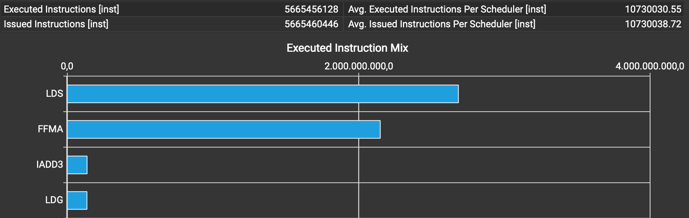
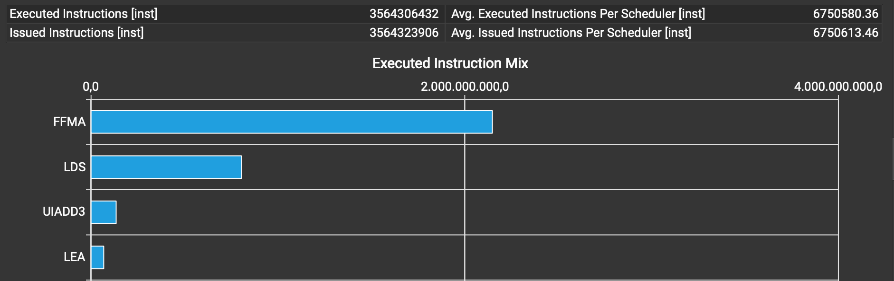

GEMM is the core operation of deep learning. This post optimizes an FP32 GEMM kernel step by step on an H100 and compares each version with cuBLAS. Code: [khanh14ph/CUDA-MatMul](https://github.com/khanh14ph/CUDA-MatMul).

## Setup

We compute $$C = \alpha AB + \beta C$$ with $$A \in \mathbb{R}^{m \times k}$$, $$B \in \mathbb{R}^{k \times n}$$, $$C \in \mathbb{R}^{m \times n}$$, all FP32, row-major and unpadded. Benchmarks use $$m = n = k = 4096$$, $$\alpha = 1$$, $$\beta = 0$$, and report $$2mnk$$ divided by the kernel time. For reference, the H100's FP32 peak is about 67 TFLOPS.

Every kernel is checked against an FP64 CPU reference before it is timed.

## v0: Naive

One thread per element of $$C$$, in $$32 \times 32$$ blocks, with `threadIdx.x` selecting the row.

```cpp
template <typename T>
__global__ void gemm_v0(int m, int n, int k, T alpha, T const* A, T const* B, T beta, T* C)
{
    int const row = blockIdx.x * blockDim.x + threadIdx.x;
    int const col = blockIdx.y * blockDim.y + threadIdx.y;

    if (row < m && col < n)
    {
        T const* A_row{A + row * k};
        T const* B_col{B + col};
        T* C_ptr{C + row * n + col};

        T sum{0};
        for (int kk{0}; kk < k; ++kk)
        {
            sum += A_row[kk] * B_col[kk * n];
        }
        *C_ptr = alpha * sum + beta * *C_ptr;
    }
}
```

**273.84 ms, 0.50 TFLOPS.** A warp is 32 threads with consecutive `threadIdx.x`, which here means 32 different rows. Each load from $$A$$ touches 32 memory sectors, 16 KB apart, instead of one contiguous chunk.

## v1: Memory Coalescing

Swap the mapping so `threadIdx.x` selects the column (and swap the grid to match). A warp now reads 32 consecutive floats of $$B$$ and one broadcast value of $$A$$.

```cpp
template <typename T>
__global__ void gemm_v1(int m, int n, int k, T alpha, T const* A, T const* B, T beta, T* C)
{
    int const col = blockIdx.x * blockDim.x + threadIdx.x;
    int const row = blockIdx.y * blockDim.y + threadIdx.y;

    if (row < m && col < n)
    {
        T const* A_row{A + row * k};
        T const* B_col{B + col};
        T* C_ptr{C + row * n + col};

        T sum{0};
        for (int kk{0}; kk < k; ++kk)
        {
            sum += A_row[kk] * B_col[kk * n];
        }
        *C_ptr = alpha * sum + beta * *C_ptr;
    }
}
```

**23.13 ms, 5.94 TFLOPS (11.8×).** Every multiply-add still needs two loads from global memory.

## v2: Shared Memory Tiling

Each block computes a $$32 \times 32$$ tile of $$C$$. At each step along $$K$$, it loads a $$32 \times 32$$ tile of $$A$$ and of $$B$$ into shared memory and computes from there, so each global load is reused 32 times.

```cpp
#define BLOCK_SIZE 32
template <typename T>
__global__ void gemm_v2(int m, int n, int k, T alpha, T const* A, T const* B, T beta,  T* C){

    __shared__ T A_shared[BLOCK_SIZE*BLOCK_SIZE];
    __shared__ T B_shared[BLOCK_SIZE*BLOCK_SIZE];
    int tid_col=threadIdx.x;
    int tid_row=threadIdx.y;

    A+=BLOCK_SIZE*blockIdx.x*k;
    B+=BLOCK_SIZE*blockIdx.y;
    C+=BLOCK_SIZE*blockIdx.x*n+BLOCK_SIZE*blockIdx.y;
    T sum=0;
    for (int kk=0;kk<k;kk+=BLOCK_SIZE){
        A_shared[tid_row*BLOCK_SIZE+tid_col]=A[tid_col+tid_row*k];
        B_shared[tid_row*BLOCK_SIZE+tid_col]=B[tid_col+tid_row*n];
        __syncthreads();
        A+=BLOCK_SIZE;
        B+=BLOCK_SIZE*n;

        for (int i=0;i<BLOCK_SIZE;i++){
            sum+=A_shared[tid_row*BLOCK_SIZE+i]*B_shared[tid_col+i*BLOCK_SIZE];
        }
        __syncthreads();
    }
    C[tid_row*n+tid_col]=alpha*sum+beta*C[tid_row*n+tid_col];
}
```

Warp Cycles Per Issued Instruction [cycle]	43.85

One or More Eligible [%]	36.32



Most of the instruction is loading from shared memory, we can optimize further by assign more work to each threads.

## v3: 1D Blocktiling

Each block computes a $$64 \times 64$$ tile, stepping through $$K$$ by 8, and each of its 512 threads computes 8 outputs in one column. A thread loads one value of $$B$$ into a register and reuses it for 8 multiply-adds, which cuts shared-memory loads from 2 to about 1.1 per multiply-add.

```cpp
// Launched with BM = BN = 64, BK = 8, TM = 8: 512 threads per block.
// Requires m % BM == 0, n % BN == 0, k % BK == 0.
template <typename T, int BM, int BN, int BK, int TM>
__global__ void gemm_v3(int m, int n, int k, T alpha, T const* A, T const* B, T beta, T* C) {
    constexpr int NT = BM * BN / TM;  // threads per block
    __shared__ T A_shared[BM * BK];
    __shared__ T B_shared[BK * BN];
    int const tid = threadIdx.x;
    int const threadRow = tid / BN;
    int const threadCol = tid % BN;

    A += BM * blockIdx.x * k;
    B += BN * blockIdx.y;
    C += BM * blockIdx.x * n + BN * blockIdx.y;

    T threadResult[TM] = {0};

    for (int kk = 0; kk < k; kk += BK) {
        for (int s = 0; s < (BM * BK) / NT; ++s) {
            int const idx = tid + s * NT;
            int const r = idx / BK, c = idx % BK;
            A_shared[r * BK + c] = A[r * k + c];
        }

        for (int s = 0; s < (BK * BN) / NT; ++s) {
            int const idx = tid + s * NT;
            int const r = idx / BN, c = idx % BN;
            B_shared[r * BN + c] = B[r * n + c];
        }
        __syncthreads();

        A += BK;
        B += BK * n;

        for (int i = 0; i < BK; ++i) {
            T const B_cell = B_shared[i * BN + threadCol];
            for (int r = 0; r < TM; ++r) {
                threadResult[r] += A_shared[(threadRow * TM + r) * BK + i] * B_cell;
            }
        }
        __syncthreads();
    }

    for (int r = 0; r < TM; ++r) {
        int const row = threadRow * TM + r;
        C[row * n + threadCol] = alpha * threadResult[r] + beta * C[row * n + threadCol];
    }
}
```
Warp Cycles Per Issued Instruction [cycle]	17.37

One or More Eligible [%]	44.84



## v4: 2D Blocktiling

```cpp
template <typename T, int BM, int BN, int BK, int TM, int TN>
__global__ void gemm_v4(int m, int n, int k, T alpha, T const* A, T const* B, T beta, T* C) {
    constexpr int NT = BM * BN / (TM*TN);  // threads per block
    __shared__ T A_shared[BM * BK];
    __shared__ T B_shared[BK * BN];
    int const tid = threadIdx.x;
    int const threadRow = tid / (BN/TN);
    int const threadCol = tid % (BN/TN);

    A += BM * blockIdx.y * k;
    B += BN * blockIdx.x;
    C += BM * blockIdx.y * n + BN * blockIdx.x;

    T threadResult[TM][TN] = {0};

    for (int kk = 0; kk < k; kk += BK) {
        // cooperative load: Since the number of threads in each block is NT now, each thread loads (BM*BK)/NT elements in A  and
        // (BK*BN)/NT elements in B 
        
        for (int s = 0; s < (BM * BK) / NT; ++s) {
            int const idx = tid + s * NT;
            int const r = idx / BK, c = idx % BK;
            A_shared[r * BK + c] = A[r * k + c];
        }

        for (int s = 0; s < (BK * BN) / NT; ++s) {
            int const idx = tid + s * NT;
            int const r = idx / BN, c = idx % BN;
            B_shared[r * BN + c] = B[r * n + c];
        }
        __syncthreads();

        A += BK;
        B += BK * n;
        T regM[TM]={0};
        T regN[TN]={0};
        for (int i = 0; i < BK; ++i) {
            for (int tm=0; tm < TM; tm++){
                regM[tm]=A_shared[(threadRow*TM+tm)*BK+i];
            }
            for (int tn=0; tn < TN; tn++){
                regN[tn]=B_shared[i*BN+threadCol*TN+tn];
            }
            for (int r = 0; r < TM; r++) {
                for (int r1 = 0; r1<TN; r1++){
                    threadResult[r][r1]+= regM[r]*regN[r1];
                }
                
               
            }
        }
        __syncthreads();
    }

    for (int r = 0; r < TM; r++) {
        int row = threadRow*TM + r;
        for (int r1 = 0; r1 < TN; r1++){
            C[row*n+threadCol*TN+r1]=alpha*threadResult[r][r1] + beta*C[row*n+threadCol*TN+r1];
        }

    }
}


```

## v5: Vectorized load

```cpp
template <typename T, int BM, int BN, int BK, int TM, int TN>
__global__ void gemm_v4(int m, int n, int k, T alpha, T const* A, T const* B, T beta, T* C) {
    constexpr int NT = BM * BN / (TM*TN);  // threads per block
    __shared__ T A_shared[BM * BK];
    __shared__ T B_shared[BK * BN];
    int const tid = threadIdx.x;
    int const threadRow = tid / (BN/TN);
    int const threadCol = tid % (BN/TN);

    A += BM * blockIdx.y * k;
    B += BN * blockIdx.x;
    C += BM * blockIdx.y * n + BN * blockIdx.x;

    T threadResult[TM][TN] = {0};

    for (int kk = 0; kk < k; kk += BK) {
        // cooperative load: Since the number of threads in each block is NT now, each thread loads (BM*BK)/NT elements in A  and
        // (BK*BN)/NT elements in B 
         
        for (int s = 0; s < (BM * BK) / (NT*4); ++s) {
            int const idx = 4*tid + s * NT;
            int const r = idx / BK, c = idx % BK;
            float4 tmp = *reinterpret_cast<const float4*>(&A[r*k+c]);
            A_shared[c*BN+r] = tmp.x;
            A_shared[(c+1)*BN+r] = tmp.y;
            A_shared[(c+2)*BN+r] = tmp.z;
            A_shared[(c+3)*BN+r] = tmp.w;

        }

        for (int s = 0; s < (BK * BN) / (NT*4); ++s) {
            int const idx = tid*4 + s * NT;
            int const r = idx / BN, c = idx % BN;
            float4 tmp = *reinterpret_cast<const float4*>(&B[r * n + c]);
            B_shared[r * BN + c] = tmp.x;
            B_shared[r * BN + c+1] =tmp.y;
            B_shared[r * BN + c+2] = tmp.z;
            B_shared[r * BN + c+3] = tmp.w;
        }
        __syncthreads();

        A += BK;
        B += BK * n;
        T regM[TM]={0};
        T regN[TN]={0};
        for (int i = 0; i < BK; ++i) {
            for (int tm=0; tm < TM; tm++){
                regM[tm]=A_shared[i*BM+ threadRow*TM+tm];
            }
            for (int tn=0; tn < TN; tn++){
                regN[tn]=B_shared[i*BN+threadCol*TN+tn];
            }
            for (int r = 0; r < TM; r++) {
                for (int r1 = 0; r1<TN; r1++){
                    threadResult[r][r1]+= regM[r]*regN[r1];
                }
                
               
            }
        }
        __syncthreads();
    }

    for (int r = 0; r < TM; r++) {
        int row = threadRow*TM + r;
        for (int r1 = 0; r1 < TN; r1++){
            C[row*n+threadCol*TN+r1]=alpha*threadResult[r][r1] + beta*C[row*n+threadCol*TN+r1];
        }

    }
}
```

This method speed up our kernel, however, it trigger another problem, which is bank conflict:
```cpp
int idx = tid*4;            // warp: tid 0..31 → idx 0..124
r = 0, c = 4*tid;
B_shared[r*BN + c + j] = ...;   // word 4*tid + j → bank (4*tid + j) % 32
```
Threads tid, tid+8, tid+16 and tid+24 hit the same bank, so each of the four scalar stores is 4-way conflicted
Fix: store the float4 in one instruction. A 128-bit STS to contiguous addresses is conflict-free:

```cpp
*reinterpret_cast<float4*>(&B_shared[r*BN + c]) = tmp;
```
## Results

| Kernel | Time (ms) | TFLOPS
|---|---:|---:|
| v0: naive | 273.84 | 0.50 |
| v1: memory coalescing | 23.13 | 5.94 |
| v2: shared memory tiling | 14.95 | 9.19 |
| v3: 1D block tiling | 7.64 | 17.98 |
| v4: 2D block tiling | 5.29 | 25.96 |
| v5: 2D block tiling | 4.48 | 30.64 | 
| cuBLAS | 2.65 | 52.05 |

Next: 2D block tiling, vectorized loads and warp tiling, then FP16 on Tensor Cores.

The v3 design follows Simon Boehm's [CUDA matmul worklog](https://siboehm.com/articles/22/CUDA-MMM).
